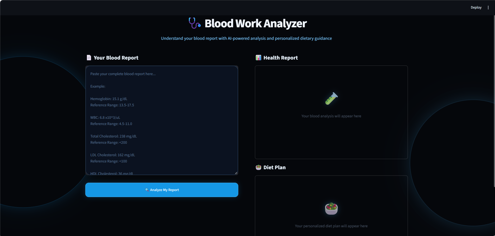
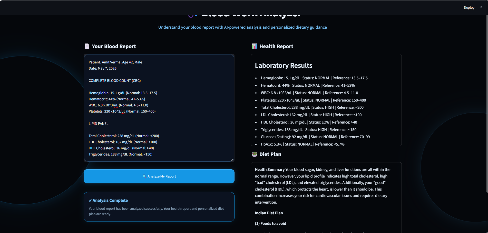

# AI-Based Health Analysis

An AI-powered blood report analysis application that helps users understand their laboratory test results through automated parameter analysis and personalised dietary recommendations.

The application analyses blood test values, identifies parameters outside their reference ranges, and generates an easy-to-understand health summary along with Indian dietary suggestions.

## Project Preview

### 1. Application Interface

The initial interface of the application, where users can provide their blood report details for analysis.



### 2. Analysed Blood Report

The application displays the analysed blood report with parameter classifications and AI-generated dietary recommendations.



## Features

- **Blood Report Analysis:** Extracts and analyses laboratory test parameters from the provided report.
- **Parameter Classification:** Categorises blood test results as HIGH, LOW, or NORMAL based on their reference ranges.
- **Health Summary:** Generates an understandable summary of the analysed blood report.
- **Dietary Recommendations:** Provides Indian diet-based food suggestions according to the analysis.
- **Two-Stage LLM Processing:** Uses two sequential LLM calls to handle blood report analysis and dietary recommendation generation separately.

## Technologies Used

- Python
- Streamlit
- Google Gemini API
- LangChain Google GenAI
- Gemma 4 (31B) – `gemma-4-31b-it`
- python-dotenv

## Project Structure

```text
AI-Based-Health-Analysis/
│
└── health_analysis_project/
    │
    ├── streamlit/
    │   ├── app.py
    │   └── images/
    │       ├── preview-image1.png
    │       └── preview-image2.png
    │
    ├── src/
    │
    ├── blood_analysis.ipynb
    ├── callingllm.ipynb
    ├── report1.txt
    ├── .env.example
    ├── .gitignore
    ├── .python-version
    ├── pyproject.toml
    ├── uv.lock
    └── README.md
```

## Installation and Setup

### 1. Clone the Repository

```bash
git clone https://github.com/shruti18sk/AI-Based-Health-Analysis.git
```

### 2. Navigate to the Project Directory

```bash
cd AI-Based-Health-Analysis/health_analysis_project
```

### 3. Install Dependencies

Make sure Python and uv are installed.

```bash
uv sync
```

### 4. Configure API Key

Create a `.env` file in the `health_analysis_project` directory and add your Google API key:

```env
GOOGLE_API_KEY=your_google_api_key_here
```

You can obtain your API key from [Google AI Studio](https://aistudio.google.com/apikey).

### 5. Run the Application

```bash
uv run streamlit run streamlit/app.py
```

The application will start locally, and Streamlit will provide a URL to access the interface.

## How It Works

The application follows a two-stage analysis workflow:

**Stage 1: Blood Report Analysis**

The first LLM call processes the blood report, extracts relevant laboratory parameters, compares their values against reference ranges, and classifies them as HIGH, LOW, or NORMAL.

**Stage 2: Dietary Recommendation Generation**

The second LLM call uses the analysis results to generate a health summary and relevant Indian dietary recommendations.

## Purpose

The project explores the use of Large Language Models in simplifying laboratory report interpretation and generating accessible, context-based dietary guidance.

**Disclaimer:** This application is intended for informational and educational purposes only. It does not provide medical diagnoses or replace professional medical advice.
